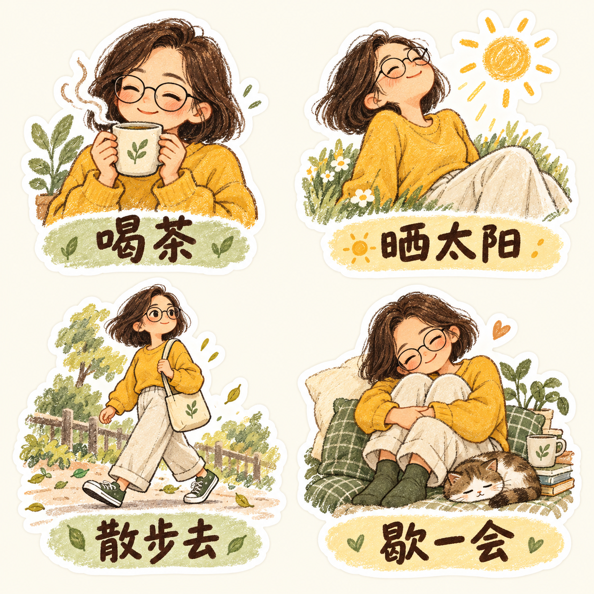
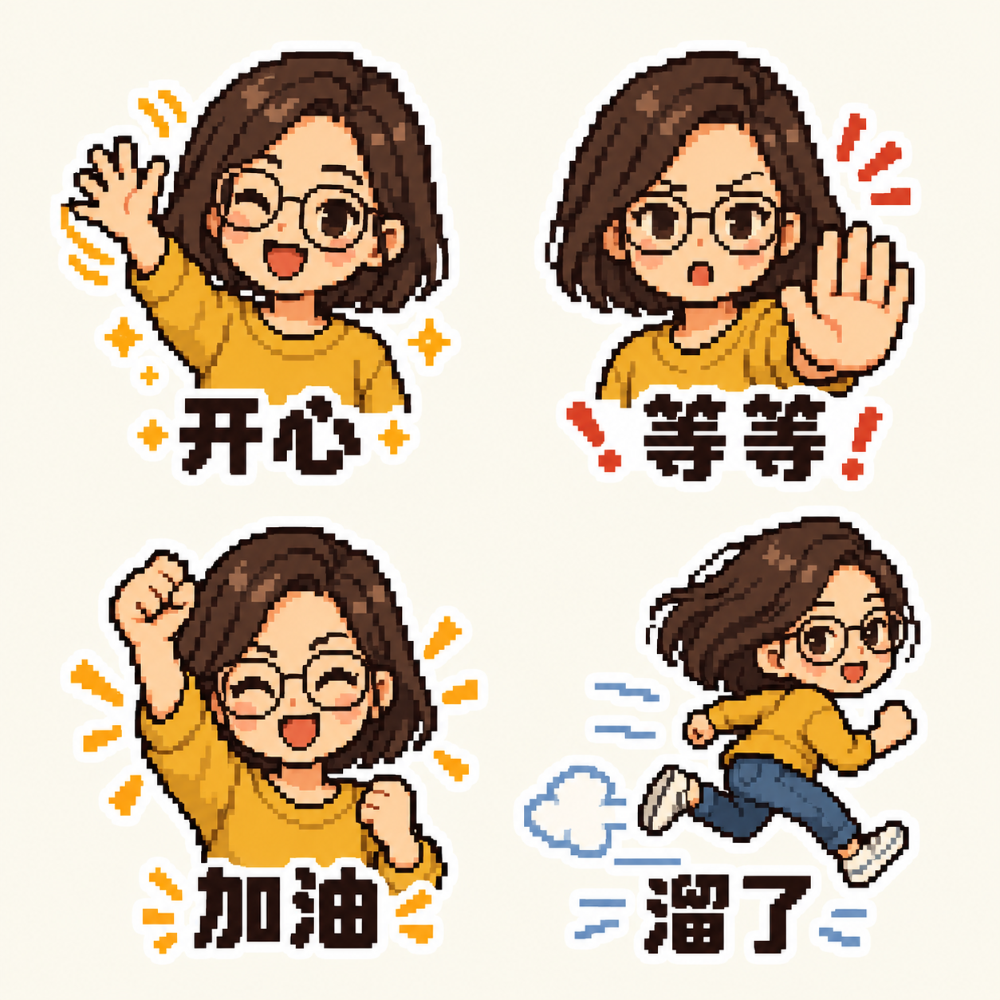
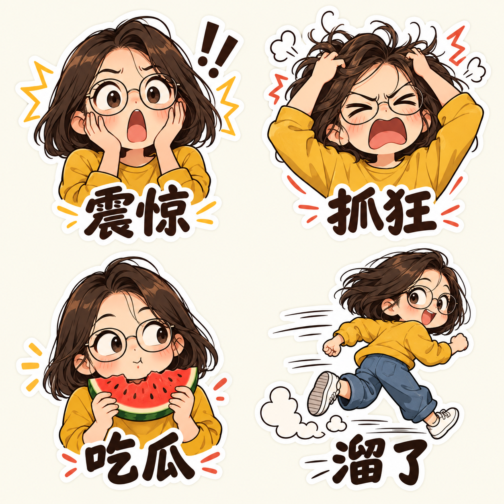
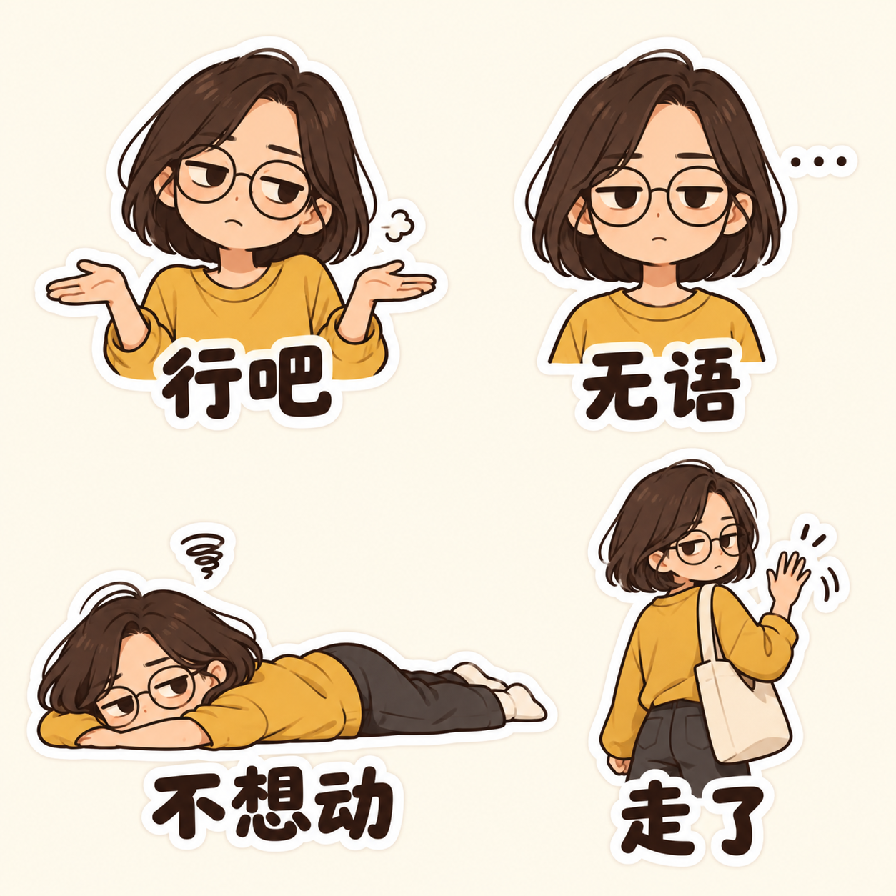
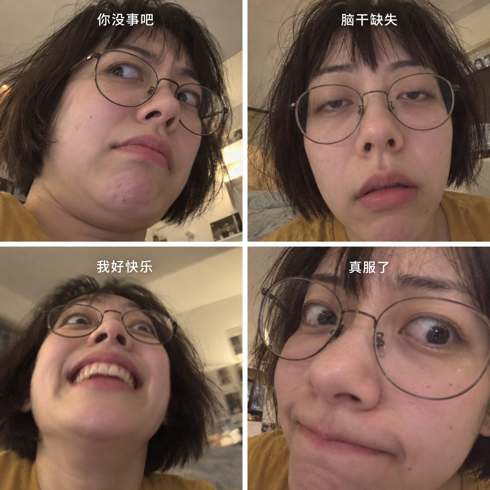

# Sticker Me · 定制你的微信表情

把你自己的形象，变成只属于你的微信表情包。

上传一张照片，选择喜欢的画风，再加入你的口头禅、常用动作和小情绪。用这套可复用的 AI 创作流程，从创意、试稿到修改定稿，定制一套像你、也符合你聊天习惯的表情，并准备微信投稿素材。

**Your face. Your style. Your stickers.**

## 可以做什么

- **定制你的形象**：保留照片里的发型、脸部特点和服装，也能按你的偏好调整。
- **定制你的表达**：用你的口头禅、动作和聊天习惯，替换模板配字与场景。
- **定制你的画风**：Q版、漫画、黏土、手绘、像素等自由搭配。
- 生成统一形象的表情，按反馈修改，并复用要求保留的单图。
- 拆分规则网格合集，导出透明 PNG / 静态 GIF、缩略图、封面、图标与横幅。
- 检查尺寸、透明背景、文件大小及安全边距，打包素材与上传文案。
- 在有可用浏览器工具且用户授权后，协助微信表情开放平台上传和提交；依据实际审核反馈继续修改。

## 使用流程改进

新角色默认先做三张试稿，分别验证像不像本人和表情好不好用；已有认可形象可直接继续。每次打包会生成离线 `review.html`，同页查看名称、简介、全部表情与封面横幅，并对比PNG/GIF深色边缘。拆图有切线风险报告，素材检查会提示完全重复的图；这些检查不能代替视觉审查。

收到审核退回截图后，按原文建立逐张修改清单，保留未受影响的定稿，重新导出完整物料。支持 Windows、macOS、Linux 的标准 Python 路径用法；尚未声称完成所有系统和真人投稿流程实测。

## 在你常用的 AI 工具中使用

任何支持图片生成的 AI 工具都可以参与制作。能读取文件或网页的助手，可以直接使用这套流程；纯生图工具也可以使用模板里的提示词。

把此仓库链接发给你常用的 AI 助手，并说：

> 请读取这个仓库的 SKILL.md 和模板，按其中的流程，用我的照片定制微信表情。先帮我选风格，做三张试稿，再根据反馈完成整套。

如果工具打不开 GitHub，下载仓库后上传 `SKILL.md` 和所选模板相关文件，或复制其中的流程、模板配方与提示词。再上传自己的照片。仅能输入生图提示词的工具，可以由你或另一个助手把模板整理成逐张提示词后生成。

不同工具能完成的步骤不同：

| 能力 | 可以完成 |
|---|---|
| 图片生成与参考图输入 | 根据照片创作表情、试稿与风格定制 |
| 图片编辑 | 根据反馈修改人物、动作与配字 |
| Python / 本地文件处理 | 使用附带脚本拆图、检查、制作预览页与打包 |
| 浏览器或电脑操作 | 在登录并获得授权后，协助上传微信平台 |

缺少后两项能力时，仍可以完成表情创作，素材处理和投稿由本地工具或用户接着完成。本仓库不提供通用于所有产品的一键安装接口，也不保证各工具自动执行完整流程。

### 支持 Skill 的 AI 助手

如果你使用的工具支持导入自定义 Skill，可以按该工具的安装方式导入本仓库；不支持 Skill 安装也能通过读取上述文件使用。

<details>
<summary>Codex 快捷安装（可选）</summary>

把仓库链接发给 Codex，说「请把这个仓库安装为我的 Skill」，或手动克隆：

```sh
git clone https://github.com/jianiye-coder/wechat-sticker-me.git ~/.codex/skills/wechat-sticker-studio
```

如果设置了 `CODEX_HOME`，使用其下的 `skills/wechat-sticker-studio` 目录。安装后若当前聊天未发现 skill，可重新打开聊天或应用。安装方式不影响其他 AI 工具直接读取流程和模板。

</details>

## 可选模板

| 模板 | 特色 |
|---|---|
| 甜甜陪伴 | 亲昵、贴贴、想念 |
| 手帐慢生活 | 手绘线条，喝茶、晒太阳 |
| 黏土小情绪 | 圆润立体，丰富小情绪 |
| 像素日常 | 复古像素，简短回应 |
| 软萌日常 | 圆润Q版、自然大眼与柔和阴影 |
| 情绪小剧场 | 弹性身体、粗笔漫画、夸张全身动作 |
| 冷脸吐槽 | 几何长脸、横线眼、克制平涂与冷幽默 |
| 打工日常 | 灰阶脸部特写＋简笔身体，黑白职场梗图 |
| 精神离线 | 低清抓拍、怼脸失真、微妙表情与短句补刀 |

下面是每种模板的实际生成示例，每张展示4个表情。示例统一使用虚构人物，正式制作会按你的照片、发型、服装和口头禅定制。图片由 AI 生成，背景和低清质感用于 README 展示，不是直接投稿的透明素材。

| 甜甜陪伴 · `sweet-company` | 手帐慢生活 · `cozy-journal` |
| :---: | :---: |
|  |  |
| **黏土小情绪 · `clay-moods`** | **像素日常 · `pixel-daily`** |
|  |  |
| **软萌日常 · `soft-daily`** | **情绪小剧场 · `drama-club`** |
|  |  |
| **冷脸吐槽 · `cool-replies`** | **打工日常 · `office-life`** |
|  |  |
| **精神离线 · `abstract-chaos`** | |
|  | |

每种含16项可编辑选题、具体动作、3张试稿建议及封面横幅方向。模板提供可编辑的完整文字配方，上图为4张效果示例；完整数量仍需按实际投稿页核实。画风和文案可以混搭，例如：

> 按 Sticker Me 的流程，选打工日常模板，画风换成黏土，用我的照片，先做三张试稿。

模板选项见 [模板指南](references/templates.md)，数据见 [catalog.json](templates/catalog.json)。

模板既区分聊天场景，也区分视觉语言：圆润Q版、弹性漫画、几何扁平、黑白拼贴，不只是在同一套Q版里更换文字。每套依然可以保留你自己的发型、眼镜和服装等特点。

## 开始使用

上传你的照片，再发送：

> 按 Sticker Me 的流程，根据我的照片做一套微信表情。从 brainstorm 开始，帮我生成、修改定稿，准备封面、横幅等素材，再协助上传审核。

也能从中途开始：

> 按 Sticker Me 的流程，把我已有的表情拆成单张，检查并打包投稿素材。

> 按 Sticker Me 的流程，保留这套的生气、疑惑和抱抱，修改其他表情。

## 环境与边界

- 生成和内容修改需要当前助手环境支持图像生成/编辑。本仓库不包含图像模型，也不附带 API 密钥。
- 附带的本地素材工具依赖 Python 3 和 Pillow；建议在项目虚拟环境安装依赖。
- 网页操作需要可用的浏览器/电脑控制工具和用户登录。扫码、实名或特定协议确认可能需要本人完成。
- 官方投稿规则可能更新。工具内参数为保守制作目标，正式投稿以当时官方页面为准。
- 不保证审核通过；保存草稿、提交审核、审核通过、上架分别记录。
- 如遇站点安全策略禁止访问，不绕过限制，改为交付完整素材供用户手动上传。
- 仓库只含通用流程与工具，不含个人照片、生成表情、登录凭据或账号资料。

官方平台：[微信表情开放平台](https://sticker.weixin.qq.com/)

## 素材工具

```sh
python scripts/prepare_assets.py --help
```

支持 `split`、`build`、`check` 三个子命令。输入清单和使用示例见 [规格与交付](references/submission.md)。图片内容仍需人工/助手视觉检查，机器校验不等于官方审核。

## 文件说明

- [SKILL.md](SKILL.md)：流程入口与行为约束。
- [references/creative.md](references/creative.md)：创意、生成与修改。
- [references/submission.md](references/submission.md)：物料规格与输入清单。
- [references/upload.md](references/upload.md)：上传、审核与失败恢复。
- [scripts/prepare_assets.py](scripts/prepare_assets.py)：本地素材处理工具。

## 本地测试

在项目虚拟环境安装 `requirements.txt` 后运行：

```sh
python -m unittest discover -s tests
```

测试覆盖完整打包、重复图提示、真实透明检查、切线风险、空图、拒绝覆盖和横幅比例。测试使用合成图片，不包含个人照片。

## License

本仓库的代码与 Skill 文档采用 [MIT License](LICENSE)，可使用、修改和分享，请保留许可与版权声明。用户上传的照片、第三方素材和各自生成的表情不因本仓库许可而自动获得授权。
